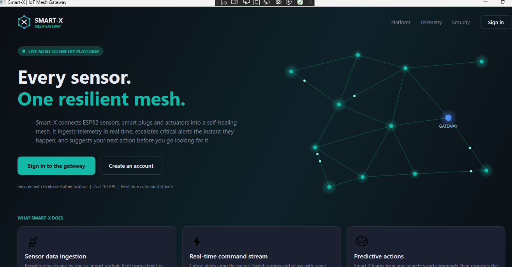
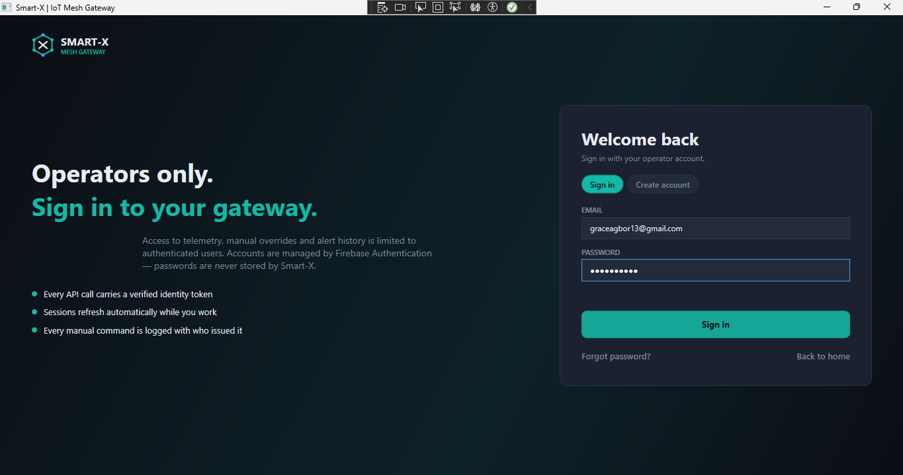
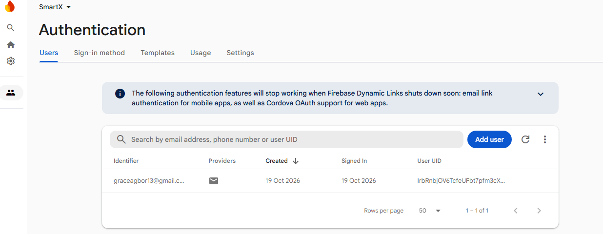

# MODULE NAME: PROGRAMMING 3B
# MODULE CODE: PROG7312 
# NAME:Grace Agbor
# STUDENT NUMBER:ST10066225
# Smart-X — Real-Time Processing and Device Management (PoE Part 2)

PROG7312 / AAPD7112 — Advanced Application Development · The Independent Institute of Education

Smart-X is a simulated IoT mesh gateway: ESP32 sensors, smart meters and actuators publish telemetry to a .NET API, and an operator
dashboard shows it live, lets the operator switch pumps/relays (with undo) and suggests actions it has learned from the operator's own behaviour.

| Project | Technology | Role |
|---|---|---|
| `SmartX.Api` | ASP.NET Core Web API (.NET 10, Controllers) | Ingestion, queues, device registry, alerts, commands, predictive engine, Firebase token verification |
| `SmartX.Client` | WPF desktop app (.NET 10) | Landing page, Firebase sign-in, three-module menu, ingestion screen, real-time command stream |

> Part 2 builds directly on Part 1 (same solution): the Part 1 features — generics, operator overloading, recursion, jagged arrays and `List<T>` — are still in the code and are now used by the Part 2 pipeline (see section 8).

---

## 1. Prerequisites

* Windows 10/11 and **Visual Studio 2022 (17.9+)** with the *.NET desktop development* and *ASP.NET and web development* workloads.
* **.NET 10 SDK.** If you only have .NET 8 or 9, change `<TargetFramework>` in both `.csproj` files (`net8.0` / `net8.0-windows`). No other change is needed, and there are **no third-party NuGet packages**.
* A free **Firebase** account (section 2) — sign-in uses Firebase Authentication, there are no hardcoded users.
* Optional: Docker Desktop (to run the API in a container).

## 2. One-time Firebase setup (about 3 minutes)

1. Go to <https://console.firebase.google.com> → **Add project** (Google Analytics can be off).
2. **Build → Authentication → Get started → Sign-in method → Email/Password → Enable → Save.**
3. **Project settings (gear icon) → General →** copy the **Web API Key**. (If it is not shown, add a *Web app* under "Your apps" and copy the `apiKey` value.)
4. Paste that key into **both** files (it is a public client identifier, not a secret):
   * `SmartX.Client/client-settings.json` → `"FirebaseApiKey"`
   * `SmartX.Api/appsettings.json` → `"Firebase": { "ApiKey": ... }`

The client signs the user in with Firebase and sends the resulting ID token with every request; the API re-verifies each token with Firebase before answering (`FirebaseAuthMiddleware`). Without a valid token every `/api/*` call returns 401.

## 3. Restore, build and run

**Option A — Visual Studio (recommended)**

1. Open `SmartX.sln` → right-click the solution → **Restore NuGet Packages** (resolves framework references only).
2. Right-click the solution → **Configure Startup Projects… → Multiple startup projects** → set **SmartX.Api** *and* **SmartX.Client** to **Start** (API listed first). Press **F5**.
   (Newer Visual Studio versions also offer the ready-made **"API + Client"** profile from `SmartX.slnLaunch.json` in the Start drop-down.)
3. The API listens on `http://localhost:5177`. The client reads the same address from `client-settings.json` (`ApiBaseUrl`).

**Option B — command line**

```powershell
dotnet build SmartX.sln
.\Start-SmartX.ps1        # starts the API in the background, then the WPF client
```

**Option C — API in Docker** (the WPF client always runs on the host)

```powershell
$env:FIREBASE_API_KEY = "<your web api key>"
docker compose up --build        # API on http://localhost:5177
dotnet run --project SmartX.Client
```

> Do a clean test before submitting: *Build → Clean Solution*, *Rebuild Solution*, then run.

## 4. Using the application

1. **Landing page** — product-style home page with an animated mesh network. *Sign in* or *Create an account* (Firebase).
2. After signing in, the **sidebar menu shows all three modules**:
   * **Sensor Data Ingestion and Telemetry** (Part 1) — register a device, attach a config/log/photo file, **import a `.txt` device list**, view the devices grid, send test readings.
   * **Real-Time Command Stream and History** (Part 2) — live dashboard (this README, sections 5–6).
   * **Network Topology and Mesh Routing** — visible but **greyed out** (delivered in the final PoE).
3. Switching tabs never loses data: each page is created once and kept alive, and the simulator and the user session live at application level.

### Importing devices from a text file
On the Ingestion screen choose **Choose .txt file and import** and pick `SampleData/sample-devices.txt`. The API reads the file, validates every line (MAC format, category, recursive Facility → Zone → Sub-zone check), registers the devices and returns a summary; the devices appear in the grid and in the Command Stream immediately. Line format:

```
MAC, Name, Category, Facility, Zone, SubZone [, Unit]      e.g.  AA:BB:CC:00:00:02, Moisture Sensor B, Environmental, Hydro Farm, Zone 1, Bed B, %
```

### Alert thresholds used by the API
| Device | Warning (out of range) | Critical (jumps the queue) |
|---|---|---|
| Moisture (%) | below 20 % or above 90 % | below 10 % |
| Temperature (°C) | ≥ 38 or ≤ 5 | ≥ 45 or ≤ 0 |
| Power (W) | ≥ 2200 W | ≥ 3000 W, **or** a jump of ≥ 1000 W between two readings |

## 5. Where each Part 2 requirement lives

All named structures are in **one class**: `SmartX.Api/Services/SmartXDataStore.cs`.

| Requirement | Structure (field name) | What it does |
|---|---|---|
| FIFO processing of telemetry | `TelemetryQueue` — `Queue<T>` | Normal packets are enqueued by `POST /api/telemetry/ingest` and drained in arrival order by `TelemetryProcessorService` |
| Critical alerts bypass the queue | `CriticalAlertQueue` — `PriorityQueue<T,(int,long)>` | Critical readings are enqueued with a priority (power first) and processed **immediately**, ahead of the FIFO queue |
| Undo manual commands | `CommandUndoStack` — `Stack<T>` | Every command is pushed; *Undo* pops and restores the saved states. An empty stack returns a message, never an exception |
| O(1) device look-up | `DeviceRegistry` — `Dictionary<string,DeviceRuntime>` keyed on MAC | Every packet finds its device with `TryGetValue`; duplicate MACs are rejected with `TryAdd` |
| Ordered history for timeline graphs | `SensorTimeline` — `Dictionary<mac, SortedDictionary<DateTime,SensorReading>>` | Readings are kept sorted by timestamp; the dashboard sparklines read them in order |
| No duplicate alerts | `ActiveAlertKeys` + `DisconnectedNodes` — `HashSet<string>` | `HashSet.Add` returns `false` for an alert/node that is already active, so it is not raised twice |
| Predictive actions | `SmartX.Api/Services/PredictiveEngine.cs` | Records searches/commands, mines *alert → action* patterns, suggests them (section 7) |

The dashboard polls one endpoint, `GET /api/stream/snapshot`, once per second.

## 6. How to test the queues, dictionaries and sets (step by step)

**Setup (once):** sign in → *Sensor Data Ingestion* → import `SampleData/sample-devices.txt` → open *Real-Time Command Stream* → click **Start simulator** (every device now sends a packet to the API every 2 seconds).

### Test A — FIFO queue and priority queue: simulate a high-priority alert
1. In the **Test Lab** panel click **Queue burst + critical**.
2. The lab sends 20 normal moisture packets (they pile up in the FIFO queue) and then **one critical packet (4 %)**.
3. Read the Test Lab message: *"CRITICAL: … Processed immediately, ahead of N queued packet(s)."*
4. Look at the **Processing Log** (newest first). The `CRITICAL` entry has **waited 0 ms** and a sequence number *lower* than most `NORMAL` entries even though it arrived last; the `NORMAL` entries are in arrival order with waits of hundreds of ms. The **FIFO queue depth** tile rises, then drains to 0.
5. The alert appears in **Alerts**, the card turns red and the **Critical** tile shows 1.

*Other ways to raise a high-priority alert:* **Power spike** button (3400 W from Smart Meter 1), or on the Ingestion screen select *Moisture Sensor B* and send a test reading of `4`.

*API-level version (PowerShell):*
```powershell
$key = "<your web api key>"
$login = Invoke-RestMethod -Method Post -ContentType "application/json" `
  -Uri "https://identitytoolkit.googleapis.com/v1/accounts:signInWithPassword?key=$key" `
  -Body (@{ email="you@example.com"; password="your-password"; returnSecureToken=$true } | ConvertTo-Json)
$h = @{ Authorization = "Bearer $($login.idToken)" }

# normal packet -> HTTP 202 Accepted, "Queued"
Invoke-RestMethod -Method Post -Headers $h -ContentType "application/json" -Uri http://localhost:5177/api/telemetry/ingest `
  -Body '{"deviceMac":"AA:BB:CC:00:00:02","value":50,"unit":"%"}'
# critical packet -> HTTP 200, outcome "CriticalProcessed"
Invoke-RestMethod -Method Post -Headers $h -ContentType "application/json" -Uri http://localhost:5177/api/telemetry/ingest `
  -Body '{"deviceMac":"AA:BB:CC:00:00:02","value":4,"unit":"%"}'
(Invoke-RestMethod -Headers $h -Uri http://localhost:5177/api/stream/snapshot).processingLog | Select-Object seq, kind, deviceName, value, waitMs
```

### Test B — Stack (undo) never crashes
1. Click the **Pump A** card → **Turn ON**. Click **Pump B** → **Toggle**. Click **Shut down ALL** → confirm.
2. *Command history* lists three commands; the top one is the next undo.
3. Click **Undo last command** three times — the shut-down is reverted, then the toggle, then the first command (cards show the restored ON/OFF state).
4. Click **Undo** a fourth time: the message *"Nothing to undo — the command history is empty."* appears and the application keeps running.
5. Select a **sensor** card — the ON/OFF/Toggle buttons are disabled (a sensor cannot be switched).

### Test C — Dictionary (`DeviceRegistry`) and `SortedDictionary` (`SensorTimeline`)
1. Ingestion screen → register a device using a MAC that already exists → *"A device with MAC address … is already registered."* (HTTP 409, found by one dictionary lookup).
2. Import `sample-devices.txt` a second time → *"Imported 0 device(s), skipped 10 duplicate(s)"*.
3. The MAC is looked up case-insensitively: `aa:bb:cc:00:00:02` and `AA:BB:CC:00:00:02` are the same device.
4. API: `POST /api/telemetry/ingest` for an unknown MAC → **404** *"Unknown device"*.
5. Timeline order: send three readings (e.g. 50, 40, 30) to one sensor and call `GET /api/telemetry/AA:BB:CC:00:00:02/timeline?take=10` — timestamps are **ascending**, and the sparkline draws them left to right.

### Test D — HashSet (no duplicate alerts)
1. Click the **Moisture Sensor A** row on the Ingestion screen and send test readings `15`, then `14`, then `13`.
2. Exactly **one** alert appears ("moisture below 20 %"); the **Duplicates blocked** tile increases for each repeat.
3. Send `55` (recovered) and then `15` again → a **new** alert is allowed (the key was cleared on recovery).
4. In the Command Stream select a device → **Report disconnect**, then click it again: the first call raises one *Disconnected* alert; the second answers *"already in the disconnected set — duplicate alert suppressed."*

### Test E — automatic disconnect detection
1. With the simulator running, select a sensor → **Drop out selected**.
2. After about 15 seconds the card turns grey (*Disconnected*), one alert is raised and the **Disconnected** tile shows 1. Click **Drop out selected** again — the device resumes and reconnects.

### Test F — Predictive Action Engine
*Quick way:* click **Train the engine** in the Test Lab (about 20 seconds). It performs the real routine three times through the API — *Moisture Sensor B* drops below 20 %, the operator searches **"Pump A"** and turns it ON, moisture recovers — and then drops it a fourth time. **Suggested Actions** now shows *"Search for 'Pump A'"* and *"Turn ON Pump A"* with the evidence ("3 of 4 times", confidence 75 %). **Automated Insights** flags *Moisture Sensor B* as out of range. Click **Apply** to execute a suggestion.

*Manual way:* send `15` to Moisture Sensor B → type `Pump A` in the search box and press **Enter** → select Pump A → **Turn ON** → send `55` → repeat 3 times → send `15` a fourth time: the suggestion appears before you search.

## 7. How the predictive engine works (`PredictiveEngine.cs`)
1. **Record** — every submitted search and every command is stored in a bounded history, and every alert the system raises is stored as a *trigger event*.
2. **Analyse** — when you act, the action is credited to every alert that fired in the previous **3 minutes**, building an association table *trigger → action* with a support count and a confidence (`count ÷ times the trigger occurred`).
3. **Suggest** — when a trigger is active again and a pattern has **support ≥ 2** and **confidence ≥ 50 %**, the action appears under *Suggested Actions*, with the recorded evidence. Nothing is random; with no history there are no suggestions. A suggestion disappears once you have done it during that alert.
4. **Highlight** — independent of history, the *Automated Insights* panel lists critical or out-of-range devices, sensors that stopped reporting, falling moisture / rising power trends (read from the sorted timeline) and your most-searched device.

## 8. Part 1 features carried forward

| Part 1 requirement | Where it is now |
|---|---|
| Generics | `Models/TelemetryPacket<T>` wraps every incoming reading and is the item type of the FIFO queue |
| Operator overloading | `Models/SensorReading` — `-` detects power spikes in `ThresholdPolicy`; `+` aggregates the **Total load** tile |
| Recursion | `Services/RecursiveConfigValidator` validates Facility → Zone → Sub-zone on registration and on every imported line |
| Jagged arrays → `List<T>` | `Services/IngestionPipeline` stores raw history in a `float[][]`, converts each row to `List<SensorReading>` and loads it into the timeline |
| Collections / Lists | `IngestionPipeline` registration log (`List<SensorRegistration>`); imports and grids use `List<T>` / `ObservableCollection<T>` |
| File attachment | Ingestion screen → *Browse* → multipart upload to `POST /api/sensors/{mac}/upload` |
| Engagement feature | Ingestion Health ring + live anomaly feed (Task 1 research) — now backed by real critical alerts from the queue |

## 9. API reference (all `/api/*` need `Authorization: Bearer <Firebase ID token>`)

| Method & route | Purpose |
|---|---|
| `GET /api/stream/snapshot` | Everything the dashboard shows (devices, series, alerts, queues, processing log, command history, insights) |
| `GET /api/devices?search=&category=&state=` | Search/filter devices by text, category or alert state |
| `POST /api/devices/import` | Upload a `.txt` device list (multipart field `file`) |
| `POST /api/sensors/register` | Register one device (server validates MAC + recursive configuration) |
| `POST /api/sensors/{mac}/upload` | Attach a config/log/photo file |
| `GET /api/sensors/{mac}/history` · `GET /api/telemetry/{mac}/timeline` | Readings in timestamp order |
| `POST /api/telemetry/ingest` | A device packet: `202` queued · `200` critical processed immediately · `404` unknown device · `429` queue full |
| `POST /api/commands` · `POST /api/commands/undo` · `GET /api/commands/history` | Manual override commands and the undo stack |
| `GET /api/alerts` · `GET /api/alerts/disconnected` · `POST /api/alerts/disconnect/{mac}` | Alerts and the disconnected-nodes set |
| `GET /api/insights` · `POST /api/insights/search` · `GET /api/insights/history` | Predictive engine |

Queue speed is configurable in `SmartX.Api/appsettings.json` (`Processing:IntervalMs`, `Processing:BatchSize`, `Telemetry:DisconnectAfterSeconds`).

## 10. Troubleshooting
* **"Firebase is not configured"** — paste the Web API key into both `client-settings.json` and `appsettings.json`, rebuild, restart.
* **"Could not reach the Smart-X API"** — start `SmartX.Api` first (green *API online* dot in the top bar).
* **Port in use** — change `applicationUrl` in `SmartX.Api/Properties/launchSettings.json` and `ApiBaseUrl` in `client-settings.json`.
* **Sign-in says "Email/password sign-in is not enabled"** — enable it in Firebase (section 2, step 2).

## Screenshots: lecturer feedback on Part 1

### 1. Landing page and 2. Authentication



*Product-style landing page with an animated mesh network.*





*Sign-in uses Firebase Authentication. The account appears in the Firebase console, and there are no hardcoded logins.*

<!-- SCREENSHOTS-END -->
## References

Google, n.d. *Firebase Authentication REST API*. [online] Available at: <https://firebase.google.com/docs/reference/rest/auth> [Accessed 14 October 2026].

Jamro, M., 2018. *C# data structures and algorithms: Explore the possibilities of C# for developing a variety of efficient applications*. Birmingham: Packt Publishing.

Microsoft, n.d. *HashSet<T> class*. [online] Available at: <https://learn.microsoft.com/en-us/dotnet/api/system.collections.generic.hashset-1> [Accessed 14 October 2026].

Microsoft, n.d. *PriorityQueue<TElement,TPriority> class*. [online] Available at: <https://learn.microsoft.com/en-us/dotnet/api/system.collections.generic.priorityqueue-2> [Accessed 14 October 2026].

Microsoft, n.d. *SortedDictionary<TKey,TValue> class*. [online] Available at: <https://learn.microsoft.com/en-us/dotnet/api/system.collections.generic.sorteddictionary-2> [Accessed 14 October 2026].

Nakov, S., 2013. *Fundamentals of computer programming with C#*. [e-book] Veliko Tarnovo: Faber. Available at: <https://introprogramming.info> [Accessed 14 October 2026].
